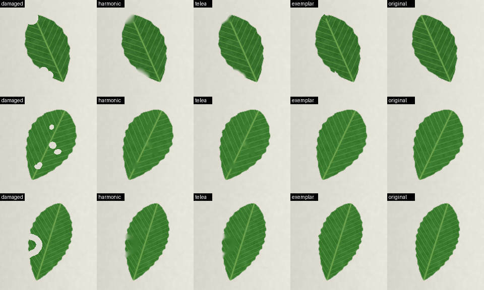

# leaf-inpainting

[](https://github.com/liuweisu/leaf-inpainting/actions/workflows/ci.yml)
**[Paint damage on a leaf and restore it in your browser](https://liuweisu.github.io/leaf-inpainting/)**

Restoring damaged leaves in images: insect bites in the margin, shot holes, tears. Before measuring leaf area or shape from a photo, the missing tissue has to be filled in, and the fill has to put the leaf edge where it really was.

In my MSc thesis I used generative inpainting models for this and found that they often produce leaf shapes that look convincing and are wrong. This repository is the classical side of that work, and an evaluation that catches the problem:

- Five inpainting methods, two of them written from scratch: a harmonic (Laplace equation) fill solved as one sparse linear system, and exemplar-based inpainting after Criminisi, Pérez & Toyama (2004).
- Synthetic leaves where the intact leaf is known exactly, with three kinds of damage.
- A **leaf-shape metric** next to PSNR and SSIM, because pixel metrics barely notice a bitten leaf.



## Results

From [`examples/benchmark.py`](examples/benchmark.py), mean over 8 synthetic leaves per damage type:

| Damage | Method | PSNR in hole (dB) | SSIM, whole image | Leaf-shape IoU in hole | Time (s) |
| --- | --- | --- | --- | --- | --- |
| bites | no restoration | 6.0 | 0.967 | 0.300 | |
| bites | harmonic (mine) | 13.8 | 0.983 | 0.603 | <0.01 |
| bites | biharmonic (scikit-image) | 13.7 | 0.984 | 0.663 | 0.01 |
| bites | Telea (OpenCV) | 12.0 | 0.980 | 0.674 | <0.01 |
| bites | Navier-Stokes (OpenCV) | 11.9 | 0.980 | 0.715 | <0.01 |
| bites | **exemplar (mine)** | **15.7** | **0.988** | **0.892** | 0.52 |
| holes | harmonic | 29.2 | 0.995 | 1.000 | <0.01 |
| holes | **exemplar** | **33.9** | **0.999** | 0.999 | 0.34 |
| tear | harmonic | 22.7 | 0.992 | 0.949 | <0.01 |
| tear | **exemplar** | **24.8** | **0.996** | **0.981** | 0.40 |

Full table: [`examples/benchmark_output.md`](examples/benchmark_output.md).

What this shows:

1. **Whole-image SSIM is almost useless here.** The damaged leaf, before any restoration, already scores 0.967. Every method lands between 0.98 and 0.99.
2. **Holes inside the blade are easy; bites in the margin are hard.** Inside the leaf every method recovers the tissue. On the margin, diffusion methods blend leaf green into the background and leave a soft dent (shape IoU 0.60 to 0.72). Exemplar inpainting continues the edge and the vein texture (0.89), but it is not perfect: you can see small steps where it copied a patch with a slightly different edge angle.
3. **Generative models need the same check.** A model that has learned what leaves look like will happily draw a full, smooth margin, whether or not that was the real shape. The shape metric is how I would compare LaMa, Stable Diffusion inpainting or BrushNet against these baselines (adapter in [`deep.py`](src/leafinpaint/deep.py)).

## How exemplar inpainting works

Repeat until the hole is filled:

1. For every pixel on the fill front, compute a priority: **confidence** (how much of its patch is known) × **data term** (how strongly an image edge, such as a vein or the leaf margin, runs into the hole).
2. Take the highest-priority patch and find the most similar fully known patch nearby (sum of squared differences over the known pixels).
3. Copy the missing pixels from that patch and pass on its confidence.

Filling along edges first is what keeps veins and the leaf margin continuous. See [`methods.py`](src/leafinpaint/methods.py).

## Use it

```bash
git clone https://github.com/liuweisu/leaf-inpainting
cd leaf-inpainting
pip install -e ".[dev]"

leafinpaint photo.png damage_mask.png -o restored.png --method exemplar
python examples/benchmark.py
pytest
```

```python
from leafinpaint import methods, metrics
restored = methods.inpaint(image, mask, "exemplar")   # image: HxWx3 float in [0, 1], mask: bool
print(metrics.shape_iou(restored, true_leaf_mask, mask))
```

Deep models (optional, GPU recommended): `pip install -e ".[deep]"`, then `deep.register_stable_diffusion()` adds `"sd_inpaint"` to the same interface. This adapter is not run in CI.

## Browser demo

[`docs/index.html`](docs/index.html) ports the diffusion and exemplar methods to plain JavaScript. Paint over any part of a leaf (or upload your own photo) and watch the exemplar method fill the hole patch by patch.

## Layout

```
src/leafinpaint/
  data.py       synthetic leaves and damage (bites, holes, tears) with exact ground truth
  methods.py    harmonic, biharmonic, Telea, Navier-Stokes, exemplar; one registry
  metrics.py    PSNR / SSIM and the leaf-shape metric
  deep.py       optional Stable Diffusion inpainting adapter
  cli.py
examples/       benchmark script and output
docs/           browser demo and figures
```

## License

MIT
